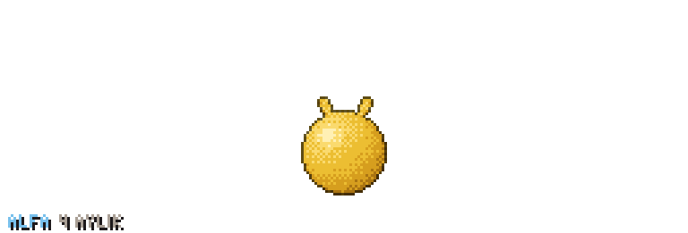

# Kayla Taştan

**AI / ML Engineer · Applied AI & Agentic Systems**

Building practical AI systems, from machine learning and model evaluation to LLM applications, RAG, and backend engineering.

**GenAI & Agents:** LLMs · RAG · LangChain · LangGraph · Embeddings · Vector Search · Tool Calling · Model Evaluation ·  Feature Engineering · Ensemble Learning · Model Training & Evaluation

**Backend & Infrastructure:** FastAPI · PostgreSQL · pgvector · SQL · Docker · Kubernetes · CI/CD

**Development:** C++ · Flutter · TypeScript 

**Let's connect!** [LinkedIn · Kayla Taştan — Catch me there ↗](https://www.linkedin.com/in/kayla-tastan/)

